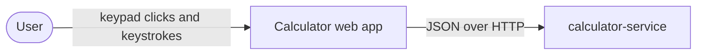
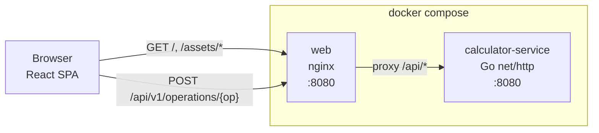
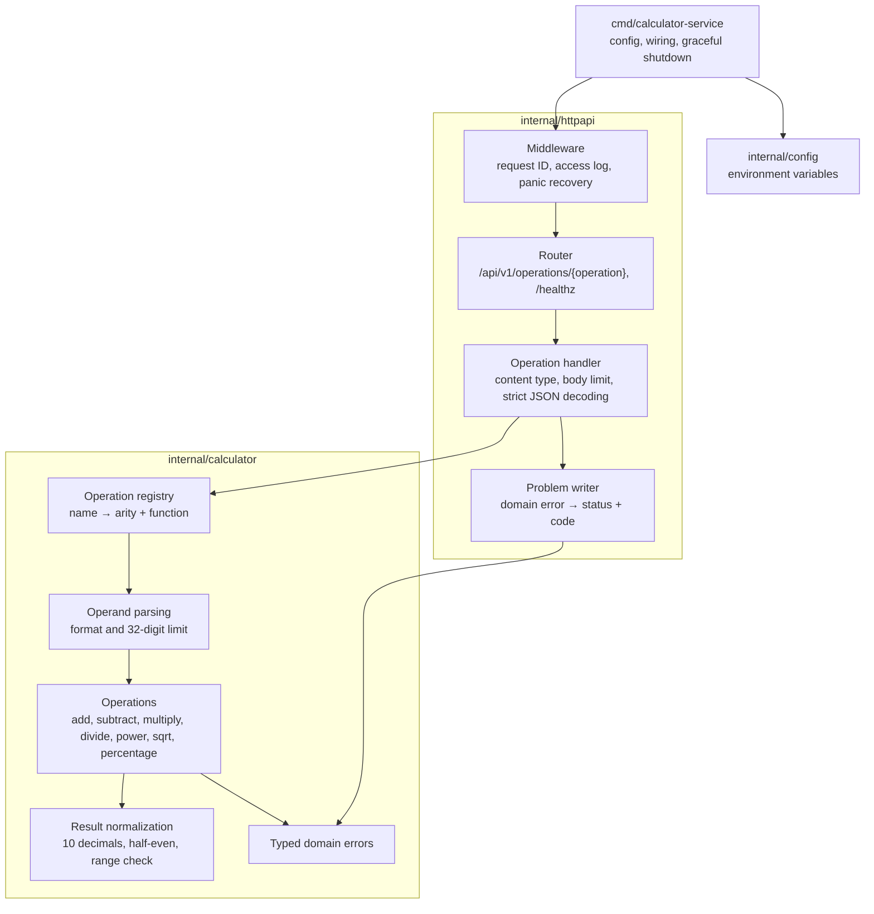
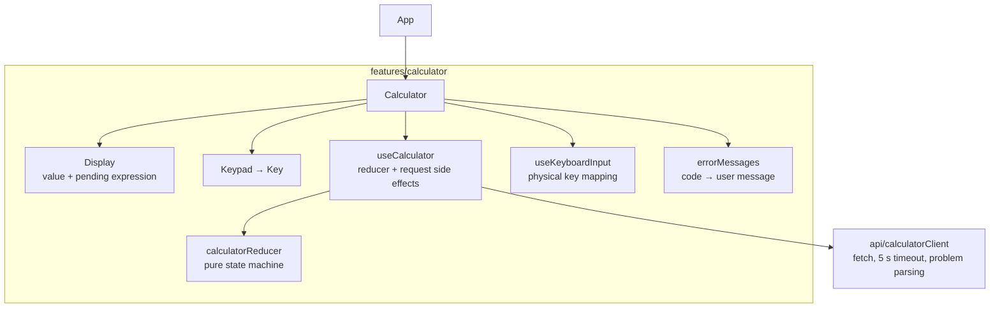
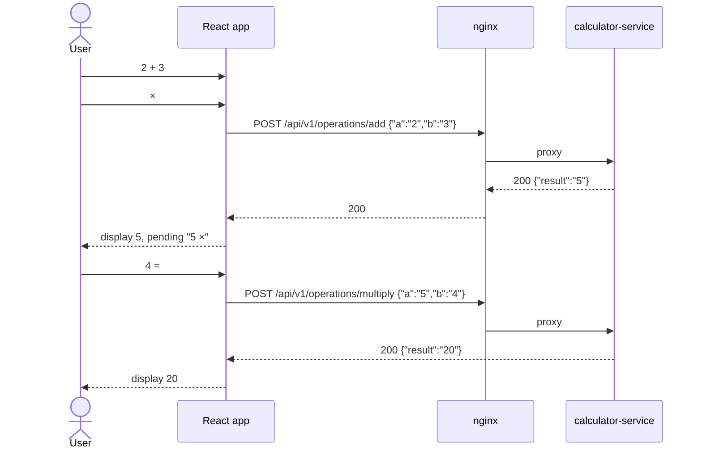
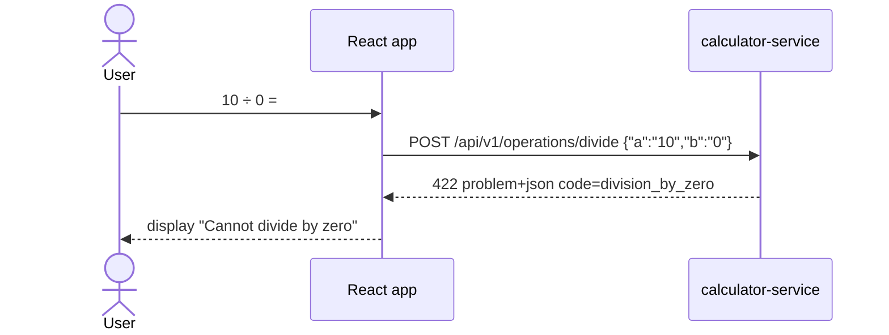
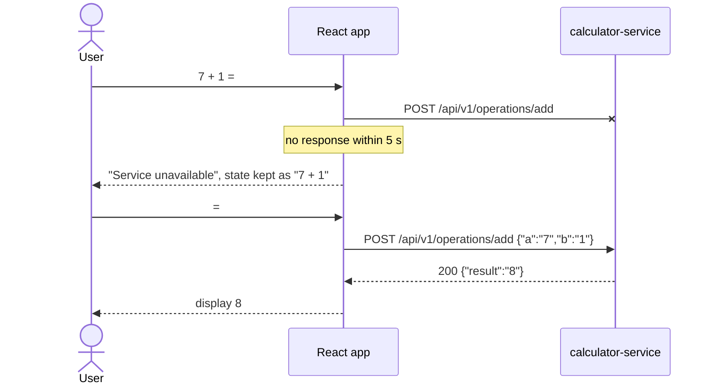

# Architecture

The system has two deployable units: a static React client served by nginx and a stateless Go microservice that owns all arithmetic. Both are reached through a single origin, so the browser never makes cross-origin requests.

## 1. System context

## 2. Containers

| Container | Technology | Responsibility |
|---|---|---|
| `web` | nginx serving the Vite production build | Serves static assets with long-lived cache for hashed files, falls back to `index.html`, reverse-proxies `/api/` to `calculator-service` |
| `calculator-service` | Go, standard library HTTP server, `cockroachdb/apd` | Validates input, performs exact decimal arithmetic, returns JSON or problem details |

During local development the Vite dev server replaces nginx and proxies `/api` to `localhost:8080`.

## 3. Backend components

- `internal/calculator` has no HTTP knowledge. It exposes the operation registry and returns typed errors that carry a stable code.
- `internal/httpapi` translates HTTP into domain calls and domain errors into RFC 9457 responses. The mapping from error to status code lives in one place.
- `cmd/calculator-service` reads configuration, builds the server with explicit timeouts, and shuts down gracefully on `SIGINT`/`SIGTERM`.

### Configuration

| Variable | Default | Purpose |
|---|---|---|
| `PORT` | `8080` | Listen port |
| `LOG_LEVEL` | `info` | `debug`, `info`, `warn` or `error` |
| `SHUTDOWN_TIMEOUT` | `10s` | Grace period for in-flight requests |

## 4. Frontend components

- `calculatorReducer` is pure and fully unit-tested. It decides *when* a request is needed and records it as pending; it never performs arithmetic.
- `useCalculator` executes the pending request through `calculatorClient` and dispatches the outcome back to the reducer.
- `calculatorClient` returns a discriminated union: a result, a business error with its code, or an unavailable outcome.

## 5. Request flows

### Successful chained calculation

### Business error

### Service unavailable

## 6. Cross-cutting concerns

| Concern | Approach |
|---|---|
| Precision | Exact decimal arithmetic in the backend only; numbers are strings end to end |
| Validation | Defense in depth: the keypad cannot produce invalid operands, and the backend validates everything independently |
| Error contract | RFC 9457 problem details with a stable `code` |
| Observability | Structured JSON logs via `log/slog`, one access log line per request with method, path, status, duration and request ID; `X-Request-ID` is accepted (1–128 visible ASCII characters) or assigned by the service and echoed back |
| Resilience | Server read, write and idle timeouts; 1 KiB body limit; panic recovery; graceful shutdown; client-side 5 s timeout |
| Security | No CORS surface (same origin); containers run as non-root; distroless runtime image for the service |
| Statelessness | No storage; the service scales horizontally without coordination |

## 7. Decisions

Significant decisions are recorded as [architecture decision records](adr/README.md).
